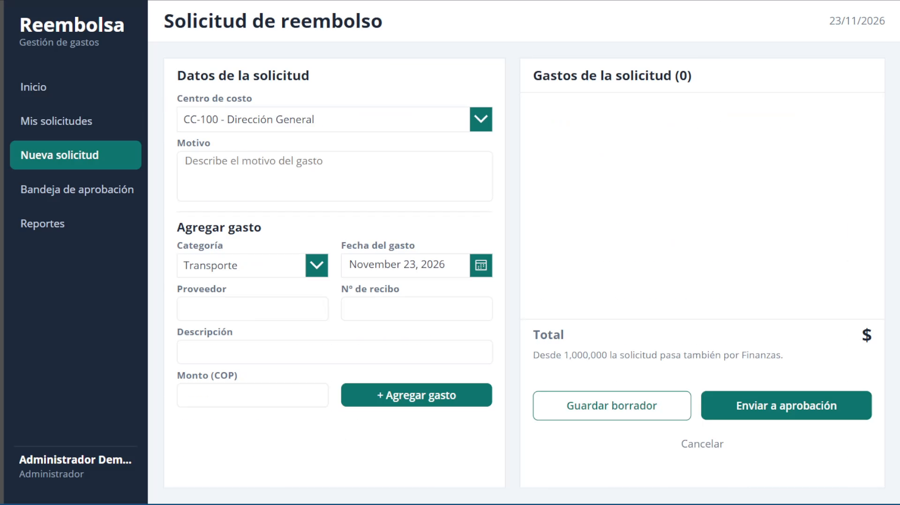
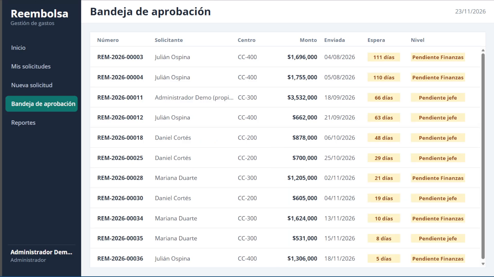
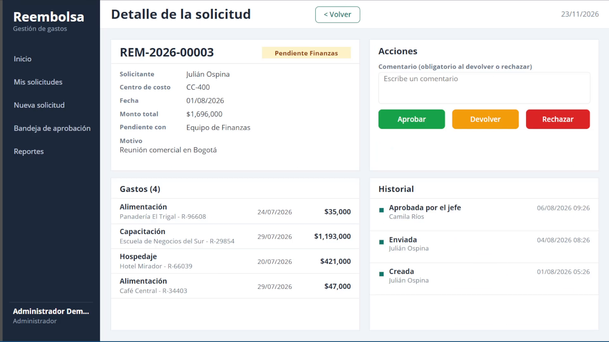
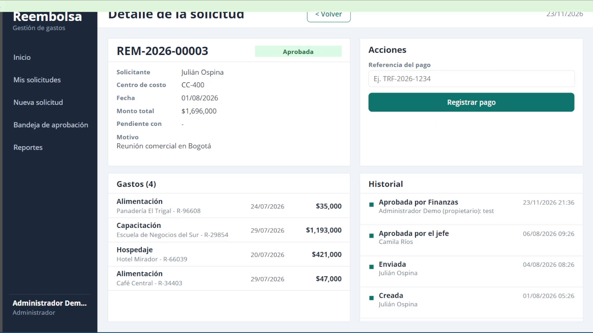

# Reembolsa

App de **reembolso de gastos con aprobación en dos niveles**, construida con **Power Apps (Canvas) y SharePoint**. Proyecto de portafolio: el dominio, los datos y los nombres son ficticios.

> Los reembolsos se pierden entre correos y hojas de Excel: nadie sabe en qué estado está cada solicitud ni quién la tiene. Reembolsa lleva todo a un solo flujo con historial.

| Nueva solicitud | Bandeja de aprobación |
|---|---|
|  |  |

| Detalle: pendiente de Finanzas | Detalle: aprobada, lista para pagar |
|---|---|
|  |  |

## Qué hace

- **Solicitud con varios gastos**, con validaciones al capturarlos (fecha, límite por categoría, recibo).
- **Flujo de aprobación:** jefe directo y, si el monto supera un umbral, también Finanzas. Se puede devolver o rechazar (con comentario obligatorio).
- **Roles:** Solicitante, Aprobador, Finanzas y Administrador, leídos de una lista de SharePoint.
- **Bandeja por rol**, con días de espera y alerta.
- **Historial** de cada decisión: quién, cuándo y por qué.
- **Reportes** por estado, centro de costo y categoría.

```
Borrador → Pendiente jefe → (monto ≥ umbral) Pendiente Finanzas → Aprobada → Pagada
                  └─────────── Devuelta / Rechazada (en cualquier aprobación) ───────────┘
```

## Lo que hay detrás

- **8 listas de SharePoint** con índices, claves únicas y relaciones por lookup. Ver [diseño y modelo de datos](docs/01-Diseno-y-Modelo-de-Datos.md).
- **Consecutivo sin duplicados** (`REM-2026-00001`): contador en una lista pequeña con `Patch` como candado y reintento, en vez de `Max` sobre la lista grande.
- **Creación con rollback:** si falla un gasto al guardar, no queda nada a medias.
- **Filtros delegables:** columnas de correo y claves de texto para que las consultas no se rompan cuando la lista crece.
- **App generada desde código:** las fuentes de Power Apps (`app/src`) salen de scripts en Python (`app/tools`) y se empaquetan con la CLI de Power Platform. Es reproducible y se puede versionar.

## Cómo ponerlo a funcionar

Necesitas un tenant de Microsoft 365 con Power Apps y un sitio de SharePoint nuevo para la demo (por ejemplo, el [programa para desarrolladores de Microsoft 365](https://developer.microsoft.com/microsoft-365/dev-program)).

1. **Crea el sitio** de SharePoint (un sitio de comunicación vacío sirve) y ábrelo en el navegador con una cuenta propietaria.
2. **Crea las listas y los datos de demostración:** pega [`scripts/aprovisionar-sharepoint.js`](scripts/aprovisionar-sharepoint.js) en la consola del navegador y ejecuta `await reembolsa.crearListas()` y luego `await reembolsa.cargarDatosDemo()`.
3. **Apunta el proyecto a tu sitio:** copia `app/tools/listas.json` como `app/tools/listas.local.json` y cambia `site` por la URL de tu sitio. Los IDs de las listas se pueden dejar: Studio los resuelve al volver a agregar las fuentes de datos.
4. **Genera y empaqueta:**
   ```powershell
   cd app
   python tools\generar-datos.py
   python tools\generar-pantallas.py
   pac canvas pack --sources src --msapp dist\Reembolsa.msapp --overwrite
   ```
5. **Importa** `dist/Reembolsa.msapp` en Power Apps Studio (Archivo → Abrir → Examinar) y, si Studio lo pide, vuelve a agregar las 8 listas desde **Datos → SharePoint**.

Más detalles, pruebas por rol y problemas conocidos en [app/README.md](app/README.md).

## Estado y límites

- Probado en Power Apps con datos ficticios: crear, enviar, aprobar, devolver y pagar.
- **Aún no sube el archivo del recibo:** exige el número de recibo. El control de adjuntos va en un formulario y queda para una próxima versión.
- Los totales de Reportes se calculan en la app sobre hasta 500 filas del período. Para producción, conviene un flujo que mantenga los totales.
- No hay pantalla de administración de catálogos: se editan directamente en SharePoint.

## Siguiente

Un asistente con IA que responda sobre estas mismas solicitudes ("¿en qué estado está mi reembolso?") y ejecute acciones.

## Licencia

[MIT](LICENSE) — Miguel Moreno.
