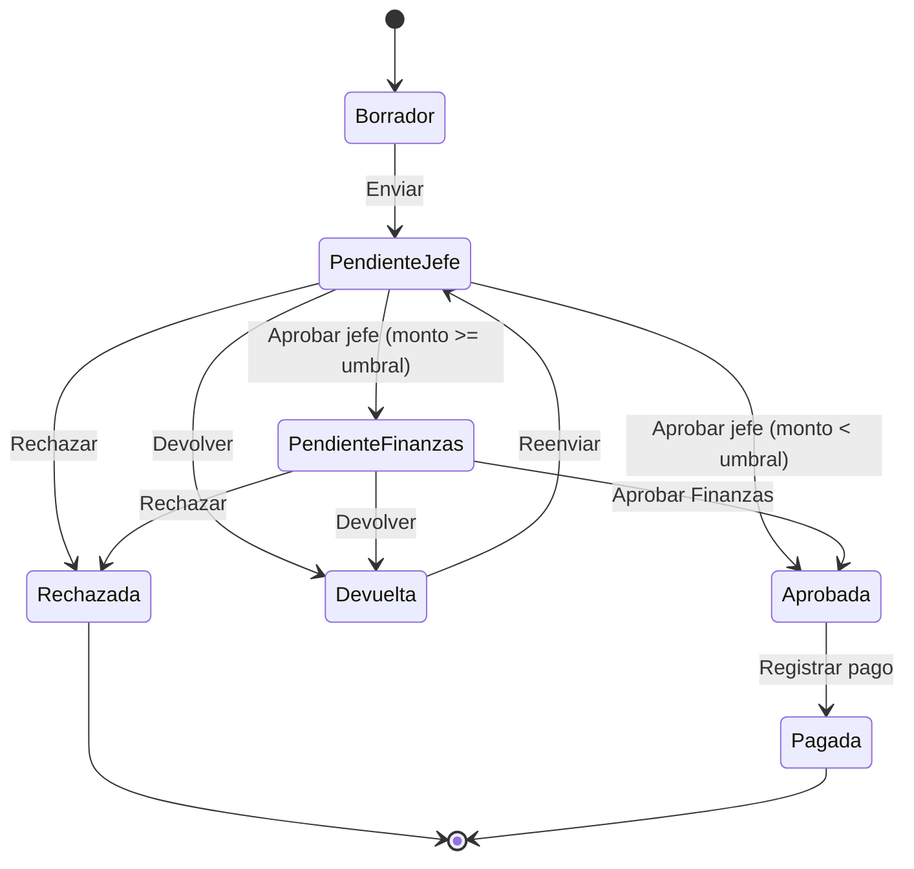
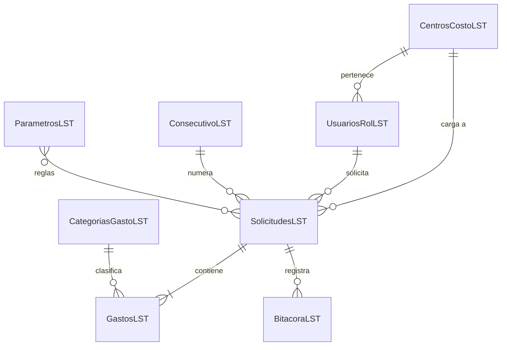

# Reembolsa — Diseño y modelo de datos (v0.1)

App Power Apps Canvas + SharePoint para gestionar reembolsos de gastos corporativos con aprobación en dos niveles. Proyecto de portafolio: dominio, datos, nombres y diseño son propios y ficticios.

## 1. Alcance

**Problema que resuelve:** los reembolsos llegan por correo con recibos sueltos, el seguimiento vive en Excel, y nadie sabe en qué estado está cada solicitud ni quién la tiene.

**Qué hace la app**
- El solicitante crea una solicitud con varias líneas de gasto y adjunta el recibo de cada una.
- Aprueba el jefe directo. Si el monto total supera un umbral, aprueba también Finanzas.
- Finanzas registra el pago con una referencia.
- Cada acción queda en una bitácora.
- Finanzas y administración ven reportes por estado, centro de costo y categoría.

**Fuera de alcance (v1):** integración con contabilidad, multi-moneda, OCR de recibos, pantalla de administración de catálogos (se editan en SharePoint).

## 2. Roles

Todos los usuarios pueden crear solicitudes. El rol agrega permisos y la jerarquía es acumulativa.

| Rol | Puede además |
|---|---|
| Solicitante | Crear y editar sus solicitudes (Borrador/Devuelta), ver las propias |
| Aprobador | Lo anterior + aprobar, devolver o rechazar las que tiene asignadas |
| Finanzas | Lo anterior + aprobar nivel 2, registrar pago, ver reportes globales |
| Administrador | Todo + ver todas las solicitudes |

El rol se lee de `UsuariosRolLST` al iniciar la app. Si el usuario no existe, se trata como Solicitante.

## 3. Flujo de estados

## 4. Reglas de negocio

| # | Regla |
|---|---|
| RN1 | Una solicitud necesita al menos una línea de gasto y monto total > 0 para enviarse |
| RN2 | La fecha de un gasto no puede ser futura ni más antigua que `DiasMaxAntiguedad` (parámetro, 60) |
| RN3 | Si la categoría tiene `LimiteMonto`, la línea no puede superarlo |
| RN4 | Si la categoría tiene `RequiereRecibo`, la línea debe tener al menos un adjunto |
| RN5 | Pasa a nivel Finanzas si `MontoTotal >= UmbralFinanzas` (parámetro, 1.000.000 COP) |
| RN6 | Nadie aprueba su propia solicitud. Si el solicitante no tiene jefe o es su propio jefe, la solicitud pasa directo a Finanzas |
| RN7 | Devolver y rechazar exigen comentario |
| RN8 | Solo el solicitante edita, y solo en Borrador o Devuelta |
| RN9 | Registrar pago exige `ReferenciaPago` |

## 5. Modelo de datos (listas de SharePoint)

Convenciones, las mismas que ya usas: sufijo `LST`, `Title` como clave de negocio visible, nombres internos sin espacios ni tildes, relaciones con columnas Lookup.

### 5.1 Catálogos

**CentrosCostoLST**

| Columna | Tipo | Notas |
|---|---|---|
| Title | Texto | Código, p. ej. `CC-100`. Único |
| Nombre | Texto | |
| Responsable | Persona | |
| Activo | Sí/No | |

**CategoriasGastoLST**

| Columna | Tipo | Notas |
|---|---|---|
| Title | Texto | Nombre de la categoría. Único |
| LimiteMonto | Número | Vacío = sin límite (RN3) |
| RequiereRecibo | Sí/No | RN4 |
| Activo | Sí/No | |

**UsuariosRolLST**

| Columna | Tipo | Notas |
|---|---|---|
| Title | Texto | Nombre completo |
| Usuario | Persona | |
| UsuarioEmail | Texto | Único, indexada. Se usa para filtrar |
| Rol | Opción | Solicitante, Aprobador, Finanzas, Administrador |
| CentroCosto | Lookup → CentrosCostoLST | |
| JefeEmail | Texto | Correo del jefe directo |
| Activo | Sí/No | |

**ParametrosLST**

| Title | Valor | Uso |
|---|---|---|
| UmbralFinanzas | 1000000 | RN5 |
| DiasMaxAntiguedad | 60 | RN2 |
| Moneda | COP | Formato en pantalla |
| DiasAlertaPendiente | 3 | Resalta solicitudes con más de N días sin atender |

**ConsecutivoLST** (patrón de contador con `Patch` como candado)

| Columna | Tipo | Notas |
|---|---|---|
| Title | Texto | Igual a `Tipo` |
| Tipo | Texto | Una fila por año: `REM-2026`. Clave del LookUp |
| Valor | Texto | Último número usado |

El número final se arma así: `Tipo & "-" & Text(Valor, "00000")` → `REM-2026-00042`. El contador se refresca y se reserva con `IfError`, y la creación solo continúa si la reserva salió bien. Todos los usuarios necesitan permiso de edición sobre esta lista, pero no de borrado.

### 5.2 Transaccionales

**SolicitudesLST**

| Columna | Tipo | Notas |
|---|---|---|
| Title | Texto | `NoSolicitud` (`REM-2026-00042`). **Único e indexada** |
| Solicitante | Persona | |
| SolicitanteEmail | Texto | Indexada. Filtro "mis solicitudes" |
| CentroCosto | Lookup → CentrosCostoLST | |
| CentroCostoCod | Texto | Copia del código, para filtrar y reportar |
| Motivo | Varias líneas | |
| FechaSolicitud | Fecha | |
| MontoTotal | Número | Suma de las líneas, calculada al enviar |
| Estado | Opción | Borrador, PendienteJefe, PendienteFinanzas, Aprobada, Devuelta, Rechazada, Pagada. Indexada |
| NivelActual | Número | 0 = borrador/cerrada, 1 = jefe, 2 = Finanzas |
| AprobadorEmail | Texto | Jefe asignado en nivel 1. Vacío en nivel 2 (lo ve todo Finanzas). Indexada |
| RequiereFinanzas | Sí/No | Resultado de RN5 |
| FechaEnvio | Fecha y hora | Para medir antigüedad del pendiente |
| FechaCierre | Fecha y hora | |
| ReferenciaPago | Texto | RN9 |
| FechaPago | Fecha | |

**GastosLST** (líneas)

| Columna | Tipo | Notas |
|---|---|---|
| Title | Texto | `NoSolicitud` como clave de relación. Indexada. Se filtra con `Title = gblNoSolicitud` |
| Solicitud | Lookup → SolicitudesLST | Para navegar en SharePoint |
| Categoria | Lookup → CategoriasGastoLST | |
| CategoriaNombre | Texto | Copia, para reportes sin cruzar listas |
| FechaGasto | Fecha | RN2 |
| Proveedor | Texto | |
| Descripcion | Texto | |
| Monto | Número | RN3 |
| NumeroRecibo | Texto | |

El recibo va como **adjunto del propio ítem** de la línea.

**BitacoraLST**

| Columna | Tipo | Notas |
|---|---|---|
| Title | Texto | `NoSolicitud`. Indexada |
| Solicitud | Lookup → SolicitudesLST | |
| Accion | Opción | Creada, Enviada, AprobadaJefe, AprobadaFinanzas, Devuelta, Rechazada, Pagada, Comentario |
| Nivel | Número | |
| Actor | Persona | |
| ActorEmail | Texto | |
| EstadoAnterior | Texto | |
| EstadoNuevo | Texto | |
| Comentario | Varias líneas | RN7 |
| FechaAccion | Fecha y hora | Cuándo ocurrió la acción (permite datos históricos de demo) |

`Created` de SharePoint queda como respaldo del momento real de inserción. La bitácora solo se inserta, nunca se edita.

## 6. Decisiones de diseño (por qué así)

1. **Delegación.** Todos los filtros usan una columna de texto o número a la izquierda, comparada con `=` contra una variable escalar. Por eso existen `SolicitanteEmail`, `AprobadorEmail`, `CentroCostoCod` y `Title` como clave en `GastosLST` y `BitacoraLST`: filtrar por Persona o por Lookup es frágil. El estado se filtra con `Estado.Value = x`.
2. **Sin `Max`, `CountRows` ni `Distinct` sobre listas grandes.** El consecutivo sale de `ConsecutivoLST`. Los KPIs de inicio usan `CountRows(Filter(...))` solo sobre conjuntos acotados al usuario. Para reportes globales, ver "Pendiente" más abajo.
3. **Orden seguro de una aprobación.** Primero se actualiza la solicitud con `IfError(Patch(...))`. Solo si salió bien se escribe la bitácora. Si falla la bitácora se avisa, porque el estado de la solicitud es la fuente de verdad. Con ese orden nunca queda un cambio de estado sin aplicar.
4. **Creación atómica.** El encabezado se crea después de reservar el consecutivo. Si falla una línea, se borran las líneas ya creadas y luego el encabezado (rollback compensatorio, hijos primero).
5. **Nivel 2 como grupo.** Las solicitudes en `PendienteFinanzas` las ven todos los usuarios con rol Finanzas, sin asignar una persona. Evita bloqueos por vacaciones.
6. **Parámetros en lista.** Umbral y límites se cambian sin republicar la app.

## 7. Pantallas

| # | Pantalla | Quién | Contenido |
|---|---|---|---|
| 1 | `InicioScreen` | Todos | Tarjetas: mis borradores, en trámite, devueltas, por aprobar (si aplica). Accesos rápidos |
| 2 | `MisSolicitudesScreen` | Todos | Galería con búsqueda por número (`StartsWith`), filtro por estado y paginación |
| 3 | `NuevaSolicitudScreen` | Todos | Encabezado (centro de costo, motivo) + grilla de líneas con adjunto + total. Guardar borrador / Enviar |
| 4 | `DetalleSolicitudScreen` | Según rol | Encabezado, líneas, línea de tiempo de bitácora y botones de acción según rol y estado |
| 5 | `BandejaScreen` | Aprobador, Finanzas | Pendientes asignados al usuario (o todos los de nivel 2). Alerta si pasan de `DiasAlertaPendiente` |
| 6 | `ReportesScreen` | Finanzas, Administrador | Total por estado, centro de costo y categoría, tiempo promedio de aprobación, filtro por mes |

Navegación: barra lateral con iconos y el rol visible en el pie. Pantalla inicial con soporte de `Param("ID")` para abrir una solicitud desde un enlace de correo.

## 8. Diseño visual

Misma estructura que usas (formulas con nombre en `App`, tokens de color, fuente Open Sans), otra identidad.

| Token | Valor | Uso |
|---|---|---|
| `ColorPrimario` | `#0F766E` | Encabezado, botón principal, selección |
| `ColorOscuro` | `#1E293B` | Barra lateral y textos fuertes |
| `ColorFondo` | `#F1F5F9` | Fondo de pantallas |
| `ColorTarjeta` | `#FFFFFF` | Tarjetas y galerías |
| `ColorTexto` | `#334155` | Texto base |
| `ColorAcento` | `#F59E0B` | Alertas y pendientes |
| `ColorExito` | `#16A34A` | Aprobada, Pagada |
| `ColorError` | `#DC2626` | Rechazada |
| `ColorInfo` | `#0284C7` | En trámite |

Insignias de estado con color y texto, nunca solo color. Prefijos de variables y controles: `gbl` globales, `ctx` contextuales, `col` colecciones, `lbl`, `btn`, `gal`, `ico`, `con`.

## 9. Datos de prueba (ficticios)

- 8 usuarios (1 administrador, 2 Finanzas, 2 aprobadores, 3 solicitantes) con nombres y correos inventados del tenant de desarrollo.
- 5 centros de costo, 6 categorías (Transporte, Alimentación, Hospedaje, Material de oficina, Capacitación, Otros).
- Unas 40 solicitudes repartidas en todos los estados y en 4 meses, para que los reportes se vean con datos.
- Los datos se crean con [`scripts/aprovisionar-sharepoint.js`](../scripts/aprovisionar-sharepoint.js).

## 10. Pendiente

- Subir el archivo del recibo (control de adjuntos en un formulario) para cumplir del todo la regla RN4.
- Reportes con muchas filas: para la demo bastan los datos de prueba. Para producción, un flujo que mantenga una lista de totales.
- Notificaciones por correo: al aprobador cuando llega una solicitud y al solicitante cuando cambia de estado.
- Pantalla de administración de catálogos.
